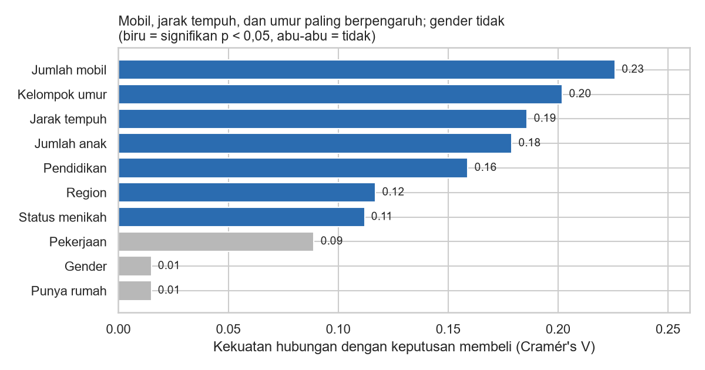
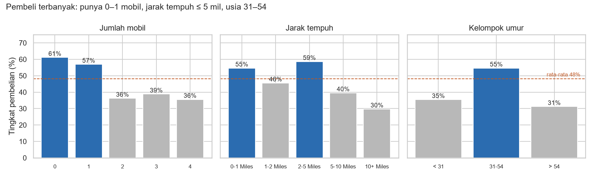
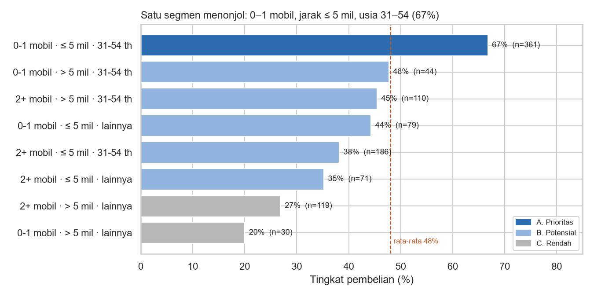
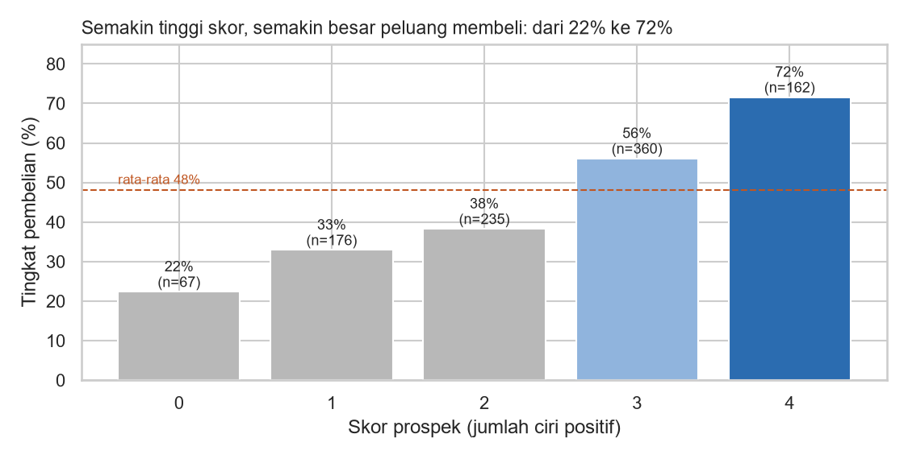

# Segmentasi Pelanggan: siapa yang harus ditarget kampanye sepeda?

Tim pemasaran toko sepeda ingin memfokuskan kampanye. Proyek ini menjawab dua pertanyaan dari data 1.000 pelanggan:
1. Pelanggan mana yang paling mungkin membeli sepeda?
2. Seberapa besar manfaatnya kalau kampanye hanya ditujukan ke kelompok itu?

**Tools:** Python · pandas · scipy (chi-square, Cramér's V) · matplotlib · seaborn

**Notebook lengkap:** [`Segmentasi-Pelanggan.ipynb`](Segmentasi-Pelanggan.ipynb)

**Data:** dataset Bike Buyers dari [Alex The Analyst](https://github.com/AlexTheAnalyst/Excel-Tutorial), sudah dibersihkan di proyek Excel saya (1.000 pelanggan, tingkat pembelian 48,1%).

---

## Ringkasan hasil
| | Pelanggan | Tingkat pembelian | Porsi dari seluruh pembeli |
|---|---|---|---|
| **Segmen Prioritas** (0–1 mobil · jarak ≤ 5 mil · usia 31–54) | 36% | **66,8%** | **50%** |
| Pelanggan dengan skor prospek 3–4 | 52% | 60,9% | 66% |
| Seluruh pelanggan | 100% | 48,1% | 100% |

## 1. Faktor yang berpengaruh

Setiap kolom diuji dengan **chi-square**, lalu kekuatannya dibandingkan dengan **Cramér's V**.
- Tiga faktor terkuat: **jumlah mobil, kelompok umur, dan jarak tempuh**.
- **Gender dan kepemilikan rumah tidak berpengaruh** (p = 0,63).

## 2. Tingkat pembelian per faktor utama

Pelanggan yang punya 0–1 mobil, jarak tempuhnya ≤ 5 mil, dan berusia 31–54 tahun membeli jauh di atas rata-rata.

## 3. Delapan segmen

Ketiga faktor dijadikan dua kategori masing-masing, sehingga terbentuk 2 × 2 × 2 = 8 segmen.
- Satu segmen menonjol: **0–1 mobil · ≤ 5 mil · 31–54 tahun**. Tingkat pembeliannya 67%, menyumbang separuh dari seluruh pembeli. Perbedaannya dengan segmen lain sangat signifikan (chi-square, p ≈ 10⁻¹⁸).
- Segmen terendah adalah pelanggan dengan jarak > 5 mil di luar usia 31–54 (20–27%).

## 4. Skor prospek untuk daftar kampanye

Setiap pelanggan mendapat 1 poin untuk setiap ciri positif: 0–1 mobil, jarak ≤ 5 mil, usia 31–54, dan lajang. Tingkat pembelian naik dari **22% (skor 0)** menjadi **72% (skor 4)**.
Dengan menarget skor 3–4 saja (setengah dari pelanggan), kampanye tetap menjangkau **dua pertiga calon pembeli**.

## 5. Profil segmen Prioritas
- 68% bergelar sarjana (pelanggan lainnya 37%).
- Income rata-rata **lebih rendah**: $49.806 vs $60.063. Kemungkinan sepeda dipakai sebagai alat transportasi hemat, bukan barang mewah.
- Lebih muda (rata-rata 40 tahun) dan anaknya lebih sedikit (1,5).
- Mayoritas berada di Europe dan North America.

## Rekomendasi
1. Fokuskan kampanye pada **segmen Prioritas**, dengan pesan *"sepeda untuk ke kantor: hemat dan sehat"*.
2. Gunakan **skor prospek** untuk menyusun daftar kontak. Skor 3–4 memberi hasil terbaik dengan biaya kampanye sekitar separuhnya.
3. Kampanye tidak perlu dibedakan berdasarkan gender.
4. Untuk pelanggan dengan jarak tempuh > 5 mil, uji produk lain (misalnya sepeda listrik) dalam kampanye kecil terlebih dahulu.

## Keterbatasan
- Data latihan: 1.000 pelanggan dari satu periode waktu.
- Hubungan yang ditemukan **bukan sebab-akibat**.
- Segmentasi dibuat dengan aturan sederhana (*rule-based*). Langkah lanjut: membandingkannya dengan K-Means clustering atau regresi logistik.

## Proyek terkait
Dataset yang sama: [dashboard Excel](https://github.com/Dewi1717/excel-bike-buyers) · [dashboard Power BI](https://github.com/Dewi1717/powerbi-bike-buyers)

**Menjalankan ulang:** `pip install pandas scipy matplotlib seaborn jupyter`, buka notebook, lalu pilih *Run All*.
